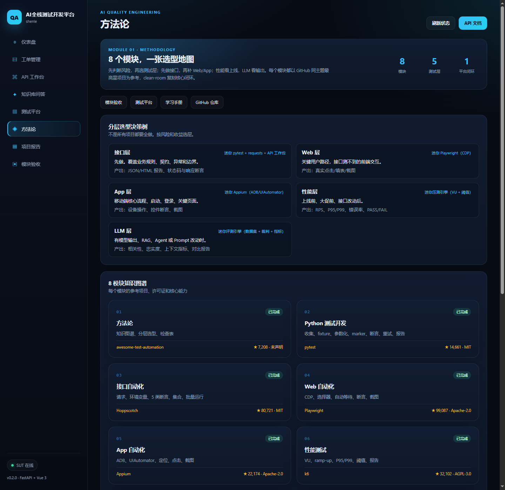

# 模块 01 验收：方法论

## 1. 参考项目

| 项目 | Stars | License | 链接 | 为什么选它 |
|---|---:|---|---|---|
| atinfo/awesome-test-automation | 7,208 | 未声明 | https://github.com/atinfo/awesome-test-automation | 测试自动化领域最完整的索引型项目，适合抽成知识地图与分层选型决策树 |

本模块没有复制清单正文，也没有 fork。交付物是一张原创的方法论页面，把 8 个模块、5 个测试层、协作流程和检查表串起来。

## 2. 复刻范围与非目标

### 已实现

- 8 模块知识图谱：参考项目、star、license、核心能力、验收入口
- 5 层选型决策树：接口、Web、App、性能、LLM
- AI 协作流程：需求 → 风险 → 选层 → 数据 → 自动化 → 报告 → 回归
- 落地检查表：10 条
- 页面：`/ui/#/methodology`

### 明确不做

- 不复制 awesome-test-automation 的工具清单正文
- 不做工具导航站
- 不做自动选型算法
- 不替代各模块的验收文档

## 3. 架构与数据流

```
Vue Methodology.vue
  ├─ 8 模块数组（参考项目 / star / license / 能力 / 入口）
  ├─ 5 层选型数组（什么时候用 / 怎么做 / 产出）
  ├─ 7 步协作流程
  └─ 10 条落地检查表
        │
        └─ 链接到 /portfolio、/platform、/learning、GitHub
```

纯前端页面，不新增后端接口。

## 4. 原理

### 风险优先

不是所有项目都要做全层测试。先看：

- 钱：支付、计费、退款；
- 权限：登录、越权、数据隔离；
- 数据：写入、迁移、删除；
- 用户路径：注册、下单、查询。

高损失的地方先测。

### 接口优先

接口测试快、稳定、ROI 高。Web/App 只补关键用户路径，不做全量 UI 回归。

### 分层选型

- 接口层：业务规则、契约、异常、边界；
- Web 层：真实点击、填表、截图；
- App 层：启动、登录、关键页面；
- 性能层：上线前、大促前、接口改动后；
- LLM 层：有模型输出、RAG、Agent 或 Prompt 改动时。

### AI 协作流程

AI 负责生成用例、跑测试、整理报告；人负责定风险、审事实、做取舍。每一步都要留下可验证产物，不能只留一句“跑过了”。

## 5. 使用步骤

```bash
cd /e/ailearning/ai-qa-lab
bash scripts/start_sut.sh
```

打开：

```
http://127.0.0.1:8000/ui/#/methodology
```

页面上的模块卡片可以直接跳到对应验收报告或平台页面。

## 6. 运行结果

| 项目 | 结果 |
|---|---|
| 模块卡片 | 8 个 |
| 测试层 | 5 个 |
| 协作流程 | 7 步 |
| 落地检查表 | 10 条 |
| 页面 | `/ui/#/methodology` |
| 截图 | `module-01-methodology.png` |

截图：



## 7. 与 awesome-test-automation 的差异、取舍、踩坑

### 差异

- 参考项目是工具清单；本模块是选型方法和项目证据链。
- 不追求工具数量，追求“什么场景选什么层、怎么验收”。

### 取舍

- 用静态数组维护 8 模块信息，简单直接；后续可以改成从 `module-matrix.md` 生成。
- 模块 01 排在最后做，因为它要总结前面所有模块的真实产物。

### 踩坑

1. **不要为了“看起来全”而全做**：层越多，维护成本越高，先做高损失路径。
2. **不要把工具当方法论**：会 Playwright 不等于会设计 Web 测试策略。
3. **不要只留截图**：每层都要有可重复运行的命令和报告。
4. **不要让 AI 替你定风险**：风险判断要人来拍板，AI 负责执行和整理。

## 8. 源码入口

| 文件 | 作用 |
|---|---|
| `apps/sut/frontend/src/views/Methodology.vue` | 方法论页面 |
| `docs/requirements/module-matrix.md` | 8 模块选型矩阵 |
| `CLAUDE.md` | 复刻规则与完成标准 |
| `docs/portfolio/` | 各模块验收文档 |

## 9. 结论

模块 01 已交付一张可访问的方法论页面：8 模块知识图谱、5 层选型、7 步协作流程、10 条检查表。它把前面 7 个模块的真实产物串成了一条证据链。
