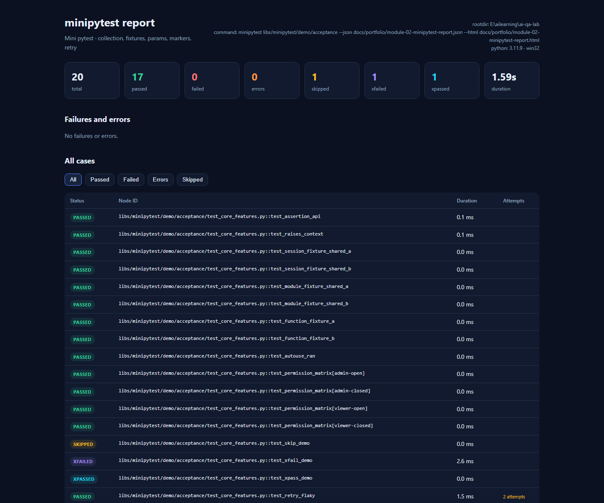

# 模块 02 验收：迷你 pytest

## 1. 参考项目

| 项目 | Stars | License | 链接 | 为什么选它 |
|---|---:|---|---|---|
| pytest-dev/pytest | 14,661 | MIT | https://github.com/pytest-dev/pytest | Python 测试事实标准，核心机制清晰，适合 clean-room 复刻 |

选型记录同步在 `docs/requirements/module-matrix.md`。本项目没有 fork、没有复制 pytest 源码，也没有把包命名为 `pytest`。框架包名是 `minipytest`，导入路径 `libs.minipytest`，真实 pytest 8.3.4 仍然可以正常工作。

## 2. 复刻范围与非目标

### 已实现

- 用例收集：`test_*.py`、模块级 `test_*`、`Test*` 类
- fixture：function / module / session 作用域、依赖注入、yield teardown、autouse
- 参数化：单层和堆叠 `@parametrize`、自定义 id、`param(..., marks=...)`
- marker：`skip`、`skipif`、`xfail`、`retry`、任意 tag、`-m` 表达式
- 断言内省：`assert_that(...)` 链式断言、expected/actual、unified diff、`raises()`
- 失败重试：全局 `--retry`、单测 `@mark.retry(n)`、attempt 记录
- 报告：JSON 机器可读、单文件离线 HTML
- 退出码：0 全绿、1 失败/错误、2 用法/收集错误、3 没有选中用例

### 明确不做

- pytest 插件/hook 系统
- class / package / fixture 参数化、`indirect`
- async 测试、并发/分布式
- 覆盖率、Allure 集成
- 根目录 `pytest.ini` 和真实 pytest 的收集行为

## 3. 架构与数据流

```
测试路径
  → collect.py：发现 test_*.py、加载 conftest、展开参数化、生成 Case
  → runner.py：按 Case 执行
       → fixtures.py：解析 fixture 依赖、创建/缓存、yield teardown
       → assertions.py：断言失败时生成 expected/actual/diff
       → marker：skip / xfail / retry
  → model.py：CaseResult、Attempt、Failure、RunResult
  → reporting.py：JSON + 离线 HTML
  → cli.py：控制台输出与退出码
```

真实 pytest 与迷你 pytest 的分工：

- 框架自身用真实 pytest 做 33 个元测试，保证引擎行为正确。
- 迷你 pytest 跑 20 个验收演示和 9 个故意失败演示，证明闭环可用。
- 两者互不覆盖，包名不冲突。

## 4. 原理

### 收集

扫描 `test_*.py`，按源码行号保留定义顺序；模块级函数和 `Test*` 类的方法都会生成 `Case`。参数化在收集阶段展开成多条 `Case`，每条有自己的 node ID。

### fixture

fixture 通过函数参数名注入。执行器先解析依赖，再调用 fixture；生成器 fixture 在 `yield` 前是 setup，`yield` 后是 teardown。作用域缓存决定复用范围：

- function：每条用例（每次重试）重新创建
- module：同一文件内复用，文件结束销毁
- session：整个 run 复用，run 结束销毁

### 参数化

`@parametrize` 可以堆叠。收集器按参数在函数签名中的位置排序，再做笛卡尔积，生成 `test[admin-open]` 这样的 ID。重复 ID 自动加 `_1`、`_2`。

### marker

`-m "smoke and not slow"` 由一个小型递归下降解析器处理，支持 `and`、`or`、`not` 和括号。`skip` 在 fixture 之前生效；`xfail` 只包住调用阶段，不掩盖 fixture 错误；`retry` 只重试调用失败。

### 断言内省

`assert_that(actual).is_equal_to(expected)` 直接拿到 actual/expected，失败时输出：

- 人类可读的 message
- expected / actual
- dict/list/string 的 unified diff
- 失败位置（跳过框架自身文件，定位到测试代码行）

### 报告

JSON 记录 run 元数据、summary、每条用例、attempts、fixture timing、失败详情。HTML 是单文件，内嵌 CSS/JS，不依赖 CDN，断网也能打开。

## 5. 使用步骤

```bash
cd /e/ailearning/ai-qa-lab

# 1. 真实 pytest：现有回归 + 框架元测试，66 passed
./.venv/Scripts/python.exe -m pytest apps/sut/backend suites/api libs/minipytest/tests -q

# 2. 迷你 pytest 验收演示：20 cases，退出码 0
./.venv/Scripts/python.exe -m libs.minipytest libs/minipytest/demo/acceptance -v \
  --json docs/portfolio/module-02-minipytest-report.json \
  --html docs/portfolio/module-02-minipytest-report.html

# 3. 故意失败演示：7 failed + 2 errors，退出码 1
./.venv/Scripts/python.exe -m libs.minipytest libs/minipytest/demo/failures -v

# 4. marker 过滤
./.venv/Scripts/python.exe -m libs.minipytest libs/minipytest/demo/acceptance -m "smoke" -v
```

SUT 启动后，报告可从控制台访问：

```
http://127.0.0.1:8000/portfolio/module-02-minipytest-report.html
```

## 6. 运行结果

| 项目 | 结果 |
|---|---|
| 真实 pytest 全量 | 66 passed（33 现有 + 33 元测试） |
| 迷你 pytest 验收演示 | 20 cases：17 passed、1 skipped、1 xfailed、1 xpassed、1 retried/flaky，exit 0 |
| 故意失败演示 | 9 cases：7 failed、2 errors，exit 1 |
| marker 过滤 | 只选中 smoke 用例，其余 deselected |
| 报告 | JSON + 离线 HTML，无外部 HTTP 资源 |
| 截图 | `docs/portfolio/screenshots/module-02-minipytest.png` |

验证截图：



## 7. 与 pytest 的差异、取舍、踩坑

### 差异

- 不做 AST 重写，用 fluent assertion 拿到 expected/actual；普通 `assert` 仍可用，但只有常规 traceback。
- 不做 fixture 参数化、indirect、class scope、package scope。
- 不实现 pytest 插件生态和 hook。
- 退出码 3 表示“没有选中用例”，与 pytest 的 5 不同，CLI 文档已写明。

### 取舍

- 先保证核心闭环可运行、可解释，再考虑扩展。框架的价值是让后续模块复用，不是追求功能数量。
- 元测试用真实 pytest，避免“用自己测自己”的循环论证。
- 报告手写 HTML，不引入 Jinja2/Allure，保持零新增运行时依赖。

### 踩坑

1. **类排序**：一开始用 `cls.__code__` 排序，类没有 `__code__`，收集直接报错。改成 `inspect.getsourcelines`。
2. **失败位置**：最初定位到框架的 `assertions.py`，因为反向查找拿到了最后一个 traceback frame。修复方式是跳过框架根目录下的直接文件，只保留测试代码帧。
3. **Windows 编码**：控制台默认 GBK，中文原因可能乱码。报告文件统一 UTF-8，控制台状态标签用 ASCII。
4. **真实 pytest 误收集演示**：在 `demo/conftest.py` 设置 `collect_ignore_glob`，避免真实 pytest 把迷你 pytest 的演示用例收进去。
5. **uvicorn 子进程泄漏**：session fixture 用 `try/finally`，terminate → wait 10s → kill，并清理临时 SQLite。

## 8. 源码入口

| 文件 | 作用 |
|---|---|
| `libs/minipytest/collect.py` | 收集、conftest、参数化展开、node ID |
| `libs/minipytest/fixtures.py` | fixture 注册、依赖解析、作用域缓存、teardown |
| `libs/minipytest/runner.py` | 执行、重试、skip/xfail、退出码 |
| `libs/minipytest/assertions.py` | fluent 断言、diff、raises |
| `libs/minipytest/reporting.py` | JSON + 离线 HTML |
| `libs/minipytest/cli.py` | `python -m libs.minipytest` |
| `libs/minipytest/tests/` | 33 个真实 pytest 元测试 |
| `libs/minipytest/demo/acceptance/` | 20 个验收演示用例 |
| `libs/minipytest/demo/failures/` | 9 个故意失败用例 |
| `libs/minipytest/README.md` | 使用说明 |

## 9. 结论

模块 02 已形成完整闭环：输入测试路径 → 收集与执行 → 结构化结果 → 离线 HTML 报告。它真实测试了 SUT 的 `/health`、工单创建/查询和知识库接口，后续模块 04/05/08 可以直接复用这套 runner 和报告格式。
