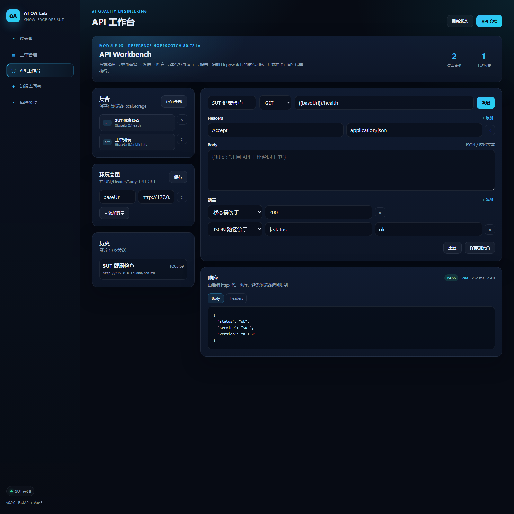

# 模块 03 复刻验收：API Workbench

> 复刻日期：2026-11-02
> 参考项目：Hoppscotch（80,721★，MIT）
> 复刻方式：clean-room 重写核心闭环，不 fork、不复制源码

## 1. 参考项目与选型

| 项 | 内容 |
|---|---|
| 项目 | [hoppscotch/hoppscotch](https://github.com/hoppscotch/hoppscotch) |
| Star | 80,721（2026-11-02） |
| License | MIT |
| 选型理由 | API 开发与测试一体化平台中 star 最高；请求、集合、环境、脚本、批量运行的核心模型完整 |
| 对照 | http-prompt（9,105★）、dredd（4,214★）功能更单一，不复刻其全部 |

## 2. 复刻范围

**已实现（v0.1 闭环）：**

- 请求构建：方法、URL、Headers、Body
- 环境变量：`{{baseUrl}}` 等占位符替换
- 后端代理发送：避免浏览器 CORS，统一超时与重定向策略
- 断言引擎：状态码、最大耗时、响应文本包含、JSON 路径存在、JSON 路径等于
- 集合：保存、加载、删除，localStorage 持久化
- 批量运行：按集合顺序执行，输出 PASS/FAIL、状态码、耗时、失败原因
- 历史记录：最近 10 次发送
- 演示模式：`/ui/#/workbench?demo=1` 自动发送健康检查，便于验收截图

**未实现（后续迭代）：**

- OAuth / API Key 管理、团队同步
- WebSocket、GraphQL、gRPC
- 请求间变量提取与链路依赖
- 代码生成、Mock Server、性能压测联动
- 完整的 SSRF 防护（当前只限制协议和云元数据地址，属于本地开发工具定位）

## 3. 架构

```
Vue Workbench (/ui/#/workbench)
  ├─ 集合 / 环境变量 / 历史（localStorage）
  ├─ 请求编辑器 + 断言编辑器
  └─ fetch /api/workbench/*
          │
          ▼
FastAPI (apps/sut/backend/app/workbench.py)
  ├─ POST /api/workbench/send
  ├─ POST /api/workbench/run
  ├─ 断言求值（服务端）
  └─ httpx.AsyncClient → 目标服务
```

为什么把发送放到后端：

1. 浏览器直接请求第三方 API 会被 CORS 拦截，后端代理没有这个限制。
2. 批量运行需要稳定超时和顺序执行，后端更适合。
3. 断言在服务端统一求值，前端只负责展示，避免两套逻辑。

## 4. 原理说明

### 变量替换

环境变量以 `{{key}}` 形式写在 URL、Header、Body 中，发送前统一替换。示例：

```
{{baseUrl}}/api/tickets  →  http://127.0.0.1:8000/api/tickets
```

### 断言求值

每个请求可挂多条断言。后端拿到响应后依次执行：

| 类型 | 判定 |
|---|---|
| `status` | HTTP 状态码等于期望值 |
| `max_ms` | 总耗时不超过阈值 |
| `body_contains` | 响应文本包含指定字符串 |
| `json_path_exists` | 按简单 JSON 路径取值且非 null |
| `json_path_equals` | 取值与期望值严格相等 |

任一条失败，整体结果标记 FAIL，并返回失败原因。

### 批量运行

集合中的请求按保存顺序串行执行，逐条返回结果。当前不做请求间依赖，保证行为可预测。

## 5. 使用步骤

1. 启动服务：

```bash
bash scripts/start_sut.sh
```

2. 打开工作台：

```
http://127.0.0.1:8000/ui/#/workbench
```

3. 默认请求是 `{{baseUrl}}/health`，点击“发送”，右侧显示 PASS、状态码、耗时、响应体。

4. 修改 URL / Headers / Body，添加断言，点击“保存到集合”。

5. 点击集合卡片的“运行全部”，下方出现批量运行报告。

6. 在左侧“环境变量”里维护 `baseUrl`，URL 中即可复用。

## 6. 验收结果

- 全量测试：**33 passed**
- 工作台契约测试：5 个（成功断言、失败断言、批量运行、非法协议、文本包含）
- 单请求实测：`health` → `passed=true`，200，235ms
- 批量运行实测：`health` + `tickets` → **2/2 passed**
- 页面截图：



## 7. 与参考项目的差异

- 只做 REST，不做 GraphQL/WebSocket。
- 集合只存浏览器本地，不做账号与云端同步。
- 断言是固定 5 种，不支持脚本级断言（Hoppscotch 支持 JS 脚本）。
- 没有请求链路变量提取，批量运行是串行且独立的。
- 复杂度集中在“请求 → 断言 → 批量报告”的真实闭环，而不是堆 UI。

## 8. 源码入口

- 前端：`apps/sut/frontend/src/views/Workbench.vue`
- 后端：`apps/sut/backend/app/workbench.py`
- 测试：`suites/api/tests/test_workbench.py`
- 路由：`apps/sut/backend/app/main.py`
