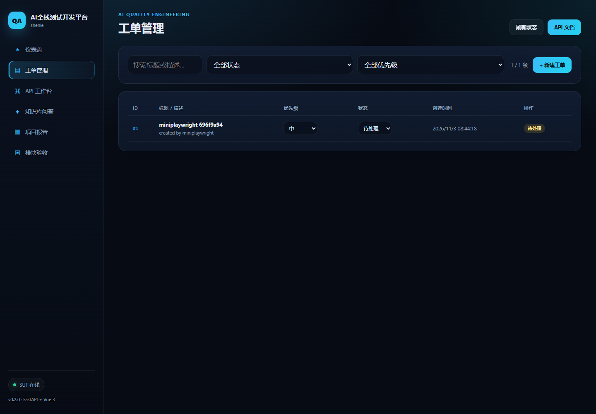

# 模块 04 验收：迷你 Playwright

## 1. 参考项目

| 项目 | Stars | License | 链接 | 为什么选它 |
|---|---:|---|---|---|
| microsoft/playwright | 99,087 | Apache-2.0 | https://github.com/microsoft/playwright | Web 自动化最高星项目，CDP/多浏览器协议和自动等待机制清晰，适合 clean-room 复刻 |

本项目没有调用 Playwright 库，也没有复制源码。实现方式是直接用 Chrome DevTools Protocol 驱动本机 Edge/Chrome。

## 2. 复刻范围与非目标

### 已实现

- 启动本机 Edge/Chrome，headless 模式
- 连接 CDP WebSocket
- `goto` 导航
- CSS 选择器定位
- `click`、`fill`、`text_content`、`is_visible`、`count`
- 自动等待：选择器等待、期望轮询
- 断言：文本、包含文本、可见、数量、URL、标题
- 截图
- 与迷你 pytest 集成：浏览器 fixture、测试报告、skip/retry

### 明确不做

- 多浏览器矩阵（只驱动本机 Chromium）
- Trace Viewer、视频录制
- 网络拦截、请求 mock
- iframe / 多标签页
- 复杂选择器（XPath、role、text 引擎）
- 代码生成/录制回放

## 3. 架构与数据流

```
miniplaywright.launch()
  → 启动 Edge/Chrome（--remote-debugging-port）
  → GET /json/list 拿到 page target
  → 连接 WebSocket（CDP）
  → Page：Page.enable / Runtime.enable / 设置视口
  → Locator：选择器 + 动作
  → Expectation：轮询直到满足或超时
  → 截图 / 结果
  → 迷你 pytest：HTML/JSON 报告
```

真实测试对象是 SUT 的 Vue 控制台：

```
测试用例
  → miniplaywright 打开 /ui/
  → 点击「工单管理」
  → 点击「新建工单」
  → 填标题和描述
  → 点击「创建」
  → 断言列表里出现新工单
  → 截图
```

## 4. 原理

### CDP

Chrome DevTools Protocol 是浏览器暴露的调试协议。启动浏览器时加 `--remote-debugging-port`，它会开一个本地 HTTP + WebSocket 服务：

- `GET /json/list`：列出可调试的页面；
- `webSocketDebuggerUrl`：页面的 CDP 地址；
- 通过 WebSocket 发送 `{id, method, params}`，浏览器返回 `{id, result}`。

### 导航与执行

- `Page.navigate` 打开 URL；
- `Runtime.evaluate` 在页面里执行 JavaScript，返回 JSON 值；
- `Page.captureScreenshot` 截图，返回 base64 PNG。

### 自动等待

Web 页面是异步渲染的。`expect(locator).to_have_text(...)` 不是查一次就结束，而是在超时时间内反复查，直到满足或超时。这样避免“页面还没渲染完就断言”的假失败。

### 为什么用 JavaScript 点击/填值

`Runtime.evaluate` 里执行 `el.click()` 和 `el.value = ...`，再派发 `input` / `change` 事件。Vue 的 `v-model` 监听这些事件，所以表单能正常更新。

## 5. 使用步骤

```bash
cd /e/ailearning/ai-qa-lab

# 框架元测试（6 个，使用本地静态 HTML）
./.venv/Scripts/python.exe -m pytest libs/miniplaywright/tests -q

# SUT UI 演示（5 个，启动 SUT 和 Edge）
./.venv/Scripts/python.exe -m libs.minipytest libs/miniplaywright/demo -v \
  --json docs/portfolio/module-04-playwright-report.json \
  --html docs/portfolio/module-04-playwright-report.html
```

单独使用：

```python
from libs.miniplaywright import expect, launch

browser = launch()
page = browser.page
page.goto("http://127.0.0.1:8000/ui/#/tickets")
expect(page.locator("h1")).to_have_text("工单管理")
page.locator(".toolbar-actions button.btn").click()
expect(page.locator(".modal")).to_be_visible()
browser.close()
```

## 6. 运行结果

| 项目 | 结果 |
|---|---|
| 框架元测试 | 6 passed |
| SUT UI 演示 | 5 passed |
| 真实操作 | 打开控制台、切工单页、创建工单、断言列表、截图 |
| 报告 | `module-04-playwright-report.html` + `.json` |
| 截图 | `module-04-dashboard.png`、`module-04-tickets.png`、`module-04-playwright-report.png` |

截图：



## 7. 与 Playwright 的差异、取舍、踩坑

### 差异

- 只支持 CSS 选择器，不支持 Playwright 的多引擎选择器。
- 不做 Trace、视频、网络拦截、iframe、多标签页。
- 点击和填值通过 `Runtime.evaluate` 执行，不是完整的输入事件管线。
- 只驱动本机 Chromium（Edge/Chrome），不做 Firefox/WebKit。

### 取舍

- 先复刻“启动 → 定位 → 操作 → 等待 → 断言 → 截图”这条主链路，够用来测试 SUT 的关键路径。
- 复用迷你 pytest 的 fixture、retry、报告，不重复造测试执行器。

### 踩坑

1. **CDP WebSocket 被拒绝**：Chrome 111+ 需要 `--remote-allow-origins=*`，否则 WebSocket 连接被 403。
2. **`websockets.connect` 弃用警告**：直接连接需要 `legacy=True`，否则提示必须用上下文管理器。
3. **Vue 表单填不进去**：只改 `el.value` 不够，必须派发 `input` 和 `change` 事件，`v-model` 才会更新。
4. **失败位置落在框架里**：期望轮询在 `assertions.py` 抛错，traceback 指向框架。给期望方法加 `__tracebackhide__`，并在迷你 pytest 的 `_find_location` 里跳过隐藏帧。
5. **SPA hash 路由**：`Page.navigate` 到 `#/tickets` 后，页面可能不重新加载。先导航到 `/ui/`，再 `goto` hash 路由，然后用选择器等待页面渲染。

## 8. 源码入口

| 文件 | 作用 |
|---|---|
| `libs/miniplaywright/browser.py` | 启动 Edge/Chrome、找 page target、清理进程 |
| `libs/miniplaywright/cdp.py` | CDP WebSocket 客户端 |
| `libs/miniplaywright/page.py` | Page / Locator / 截图 / 自动等待 |
| `libs/miniplaywright/assertions.py` | `expect(...)` 断言 |
| `libs/miniplaywright/tests/` | 6 个真实 pytest 元测试 |
| `libs/miniplaywright/demo/` | 5 个 SUT UI 用例 |
| `libs/miniplaywright/README.md` | 使用说明 |

## 9. 结论

模块 04 已形成完整闭环：启动浏览器 → 打开 SUT → 定位元素 → 操作 → 自动等待 → 断言 → 截图 → 报告。它真实创建了一条工单，证明 UI 自动化链路可用，后续模块 05/06/08 可以复用同一套迷你 pytest 执行器和报告格式。
