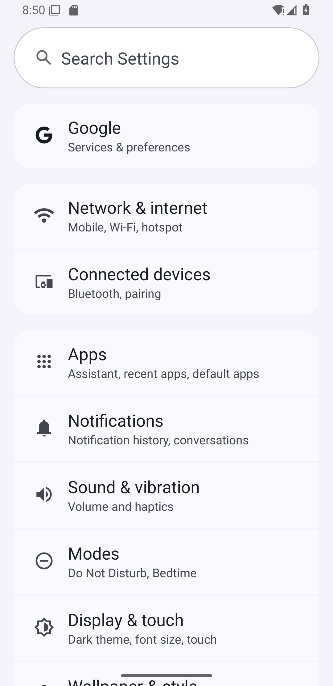

# 模块 05 验收：迷你 Appium

## 1. 参考项目

| 项目 | Stars | License | 链接 | 为什么选它 |
|---|---:|---|---|---|
| appium/appium | 22,174 | Apache-2.0 | https://github.com/appium/appium | 移动端 UI 自动化事实标准，W3C WebDriver 协议和会话/元素/手势模型清晰，适合 clean-room 复刻 |

本项目没有启动 Appium Server，也没有复制源码。实现方式是直接走 Android 的 ADB + UIAutomator。

## 2. 复刻范围与非目标

### 已实现

- 发现已连接的 Android 设备/模拟器
- 启动 Settings 应用
- `uiautomator dump` 拉取 UI 层级
- 按 text / resource-id / content-desc / class 定位
- `tap`、`swipe`、`input text`、返回键、Home 键
- 自动等待元素出现
- 断言：可见、文本、包含文本
- 截图
- 与迷你 pytest 集成：设备 fixture、报告、skip

### 明确不做

- Appium Server / WebDriver 协议
- iOS
- 手势库（长按、拖拽、多指）
- WebView / Hybrid
- 图像识别定位
- 中文输入（`adb input text` 对 CJK 不稳定，demo 用英文界面）

## 3. 架构与数据流

```
miniappium.Device.connect()
  → adb devices
  → 选中第一台设备
  → am start / force-stop
  → uiautomator dump /sdcard/window.xml
  → adb exec-out cat 拉回 XML
  → 解析 node：text / resource-id / bounds
  → tap(bounds 中心)
  → wait_for 轮询
  → screencap -p 截图
  → 迷你 pytest 报告
```

真实测试对象是 Android 模拟器 `Pixel_3a_API_36` 的 Settings：

```
打开 Settings
  → 等待 "Search Settings"
  → 点击 "Network & internet"
  → 等待 "Internet"
  → 返回
  → 再次等待 "Search Settings"
```

## 4. 原理

### ADB

ADB 是 Android Debug Bridge。电脑通过它给模拟器/真机发命令：

- `adb devices`：列出设备；
- `adb shell`：在设备上执行命令；
- `adb exec-out`：把二进制输出拉回电脑，适合截图。

### UIAutomator

`uiautomator dump` 会把当前界面的控件树导出成 XML。每个节点有：

- `text`：显示文本；
- `resource-id`：控件 ID；
- `content-desc`：无障碍描述；
- `bounds`：屏幕坐标 `[x1,y1][x2,y2]`。

定位就是在这棵树里找匹配节点，算 bounds 中心，然后 `input tap x y`。

### 自动等待

`wait_for(text="Internet")` 会反复 dump + 查找，直到出现或超时。因为页面跳转和动画是异步的，不能点完立刻断言。

## 5. 使用步骤

```bash
cd /e/ailearning/ai-qa-lab

# 1. 启动模拟器（已启动可跳过）
"D:/AndroidSdk/emulator/emulator.exe" -avd Pixel_3a_API_36_extension_level_17_x86_64 \
  -no-window -no-audio -no-boot-anim -gpu swiftshader_indirect -no-snapshot-load

# 2. 确认设备
adb devices

# 3. 框架元测试（5 个）
./.venv/Scripts/python.exe -m pytest libs/miniappium/tests -q

# 4. Settings 演示（3 个）
./.venv/Scripts/python.exe -m libs.minipytest libs/miniappium/demo -v \
  --json docs/portfolio/module-05-appium-report.json \
  --html docs/portfolio/module-05-appium-report.html
```

单独使用：

```python
from libs.miniappium import Device, expect

device = Device.connect()
device.start_settings()
home = device.wait_for(text="Search Settings")
expect(home).to_be_visible()
device.wait_for(text="Network & internet").tap()
expect(device.wait_for(text="Internet")).to_be_visible()
device.press_back()
```

## 6. 运行结果

| 项目 | 结果 |
|---|---|
| 框架元测试 | 5 passed |
| Settings 演示 | 3 passed |
| 真实操作 | 打开 Settings、点击 Network & internet、返回首页、截图 |
| 报告 | `module-05-appium-report.html` + `.json` |
| 截图 | `module-05-settings.png`、`module-05-network.png`、`module-05-appium-report.png` |

截图：



## 7. 与 Appium 的差异、取舍、踩坑

### 差异

- 不启动 Appium Server，不走 WebDriver 协议，直接 ADB/UIAutomator。
- 只支持 Android，不支持 iOS。
- 不做复杂手势、WebView、图像识别。
- 中文输入不稳定，demo 用英文 Settings。

### 取舍

- 先复刻“设备发现 → 启动 App → 定位 → 点击 → 等待 → 断言 → 截图”的主链路。
- 复用迷你 pytest 的 fixture、报告和 skip 机制。

### 踩坑

1. **Git Bash 路径转换**：`adb shell uiautomator dump /sdcard/window.xml` 被 Git Bash 转成 `C:/Program Files/Git/sdcard/...`，必须加 `MSYS_NO_PATHCONV=1` 或用 Python subprocess 传参数列表。
2. **Settings 会恢复上次页面**：直接 `am start` 可能回到上次的 Network 页面。先 `am force-stop com.android.settings` 再启动，保证回到首页。
3. **`uiautomator dump` 慢**：每次约 0.5 秒，轮询间隔不能太短，超时给 10 秒。
4. **中文输入**：`adb shell input text` 对 CJK 不稳定，demo 用英文界面。
5. **模拟器启动慢**：headless 启动约 30-60 秒，测试前要用 `adb wait-for-device` 和 `sys.boot_completed` 确认。

## 8. 源码入口

| 文件 | 作用 |
|---|---|
| `libs/miniappium/device.py` | ADB、UIAutomator dump、定位、点击、滑动、截图 |
| `libs/miniappium/assertions.py` | `expect(element)` 断言 |
| `libs/miniappium/tests/` | 5 个真实 pytest 元测试 |
| `libs/miniappium/demo/` | 3 个 Settings 演示用例 |
| `libs/miniappium/README.md` | 使用说明 |

## 9. 结论

模块 05 已形成完整闭环：连接设备 → 启动 App → 定位元素 → 操作 → 自动等待 → 断言 → 截图 → 报告。它真实操作了 Android Settings，证明移动端 UI 自动化链路可用。
