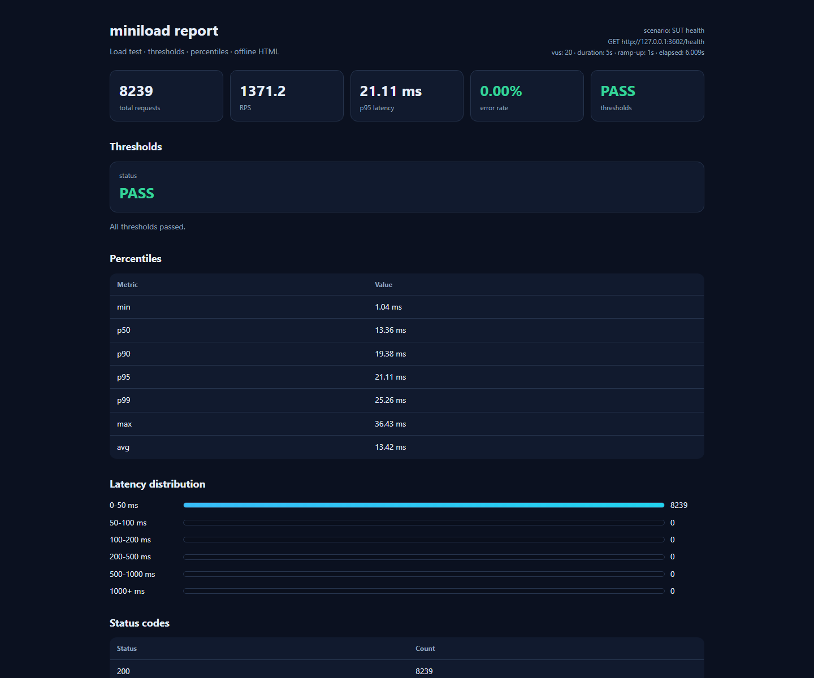

# 模块 06 验收：迷你压测引擎

## 1. 参考项目

| 项目 | Stars | License | 链接 | 为什么选它 |
|---|---:|---|---|---|
| grafana/k6 | 32,102 | AGPL-3.0 | https://github.com/grafana/k6 | 现代压测工具，场景、阈值、指标模型清晰；只参考概念，不复制 AGPL 代码 |
| locustio/locust | 28,257 | MIT | https://github.com/locustio/locust | Python 压测备选，VU 模型更接近本实现 |

本项目没有引入 k6/Locust 依赖，用 Python 线程和 requests 自己实现。

## 2. 复刻范围与非目标

### 已实现

- 常量 VU 并发
- 阶梯启动（ramp-up）
- 请求耗时采集
- P50 / P90 / P95 / P99 / min / max / avg
- RPS、错误率、状态码分布、错误 Top N
- 阈值判定：P95、错误率、最小 RPS
- JSON 报告
- 单文件离线 HTML 报告
- 命令行入口

### 明确不做

- 分布式压测
- HTTP/2、WebSocket、gRPC
- 脚本化场景（多步骤、变量、关联）
- 实时仪表盘
- 结果持久化数据库
- 精确的开放/闭环模型

## 3. 架构与数据流

```
Scenario（method / url / headers / body）
  → run_load(vus, duration, ramp_up, thresholds)
  → ThreadPoolExecutor：每个 VU 一个线程
  → 每个线程循环 requests.Session.request
  → 采集 latency / status / error
  → 合并结果
  → 计算 percentiles / RPS / error_rate
  → 阈值判定
  → JSON + 离线 HTML
```

演示对象是 SUT 的 `/health`：

```
20 VUs，5 秒，1 秒 ramp-up
  → GET /health
  → 8239 次请求
  → 1371.2 RPS
  → P95 21.11 ms
  → 错误率 0.00%
  → PASS
```

## 4. 原理

### VU 和线程

一个 VU 就是一个虚拟用户。实现上给每个 VU 开一个线程，线程里循环发请求，直到结束时间。

### Ramp-up

VU 不是同一瞬间启动，而是按时间错开。这样可以模拟“用户逐步进来”，避免启动瞬间的尖峰。

### 延迟和百分位

每次请求记录耗时。把所有耗时排序：

- P50：一半请求比它快；
- P95：95% 请求比它快；
- P99：99% 请求比它快。

平均值会被少数慢请求拉平，P95/P99 更能反映用户体验。

### 阈值

压测不只是“跑一下”，还要判断结果能不能接受：

- P95 是否超过 X ms；
- 错误率是否超过 X%；
- RPS 是否低于 X。

任何一条不满足，整体 FAIL。

## 5. 使用步骤

```bash
cd /e/ailearning/ai-qa-lab

# 框架元测试（5 个，本地 HTTP server）
./.venv/Scripts/python.exe -m pytest libs/miniload/tests -q

# 压测 SUT 的 /health，生成报告
./.venv/Scripts/python.exe -m libs.miniload.demo.run_demo

# 或直接用 CLI
./.venv/Scripts/python.exe -m libs.miniload \
  --url http://127.0.0.1:8000/health \
  --vus 20 --duration 5 --ramp-up 1 \
  --p95 500 --error-rate 0.01 --min-rps 10 \
  --json docs/portfolio/module-06-load-report.json \
  --html docs/portfolio/module-06-load-report.html
```

## 6. 运行结果

| 项目 | 结果 |
|---|---|
| 框架元测试 | 5 passed |
| 演示压测 | 8239 次请求，1371.2 RPS，P95 21.11ms，错误率 0.00%，PASS |
| 报告 | `module-06-load-report.html` + `.json` |
| 截图 | `module-06-load-report.png` |

截图：



## 7. 与 k6/Locust 的差异、取舍、踩坑

### 差异

- 不做分布式、脚本化场景、实时仪表盘。
- 用 Python 线程，不是 Go 的协程模型；本机压测上限受 Python GIL 和 requests 限制。
- 只做 HTTP，不做 WebSocket/gRPC。

### 取舍

- 先复刻“并发 → 采集 → 百分位 → 阈值 → 报告”这条主链路。
- 用标准库线程和 requests，零新增依赖，便于本地演示和 CI。

### 踩坑

1. **本机压测会先打满自己**：1371 RPS 已经接近本地 Python 线程 + requests 的瓶颈，不能当成服务端极限。
2. **平均延迟会骗人**：平均值低不代表体验好，必须看 P95/P99。
3. **错误率要区分 HTTP 错误和网络异常**：两者都算失败，但错误信息要分开记。
4. **ramp-up 时间要算进总时长**：结束时间 = 启动时间 + ramp-up + duration。
5. **报告必须离线**：HTML 内嵌 CSS，不依赖 CDN，断网也能看。

## 8. 源码入口

| 文件 | 作用 |
|---|---|
| `libs/miniload/engine.py` | VU 线程、ramp-up、延迟采集、百分位、阈值 |
| `libs/miniload/reporting.py` | JSON + 离线 HTML |
| `libs/miniload/cli.py` | 命令行入口 |
| `libs/miniload/tests/` | 5 个真实 pytest 元测试 |
| `libs/miniload/demo/run_demo.py` | 启动 SUT、压测 `/health`、生成报告 |

## 9. 结论

模块 06 已形成完整闭环：场景 → 并发执行 → 指标采集 → 阈值判定 → 离线报告。它真实压测了 SUT 的 `/health`，并给出了可解释的 RPS、P95 和错误率。
