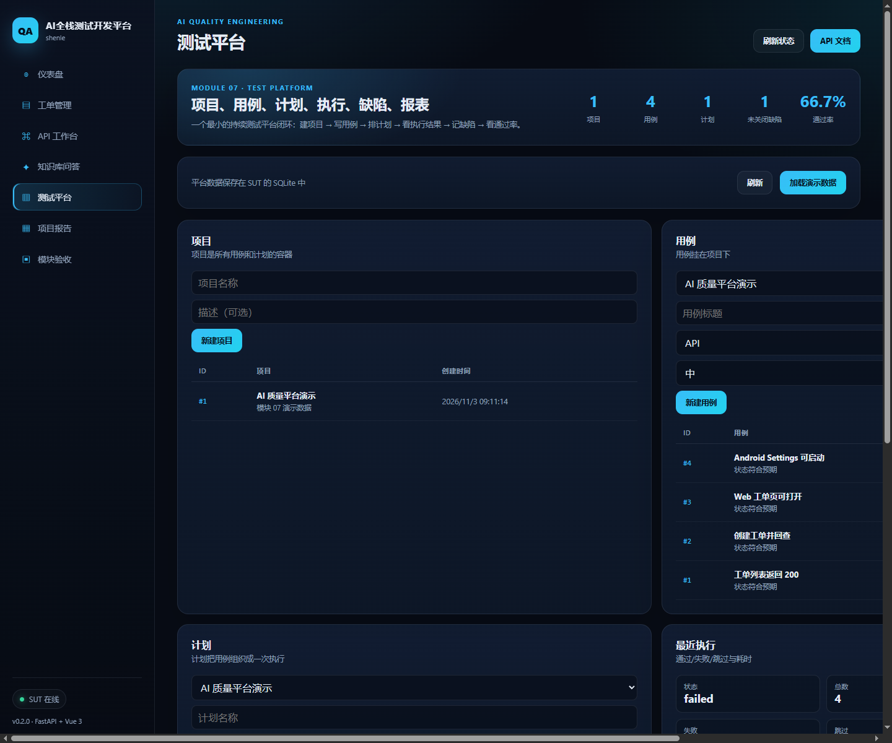

# 模块 07 验收：测试平台

## 1. 参考项目

| 项目 | Stars | License | 链接 | 为什么选它 |
|---|---:|---|---|---|
| metersphere/metersphere | 13,600 | NOASSERTION | https://github.com/metersphere/metersphere | 最贴近“持续测试平台”的高星项目，项目/用例/计划/执行/缺陷/报表闭环清晰 |

本项目没有 fork MeterSphere，也没有复制源码。平台以内置在 SUT 控制台里的方式实现，复用现有 FastAPI + Vue + SQLite。

## 2. 复刻范围与非目标

### 已实现

- 项目：创建、列表
- 用例：挂在项目下，含模块、优先级、步骤、预期
- 计划：把用例组织成一次执行
- 执行：记录总数、通过、失败、跳过、耗时、逐条结果
- 缺陷：创建、关闭
- 报表：通过率、未关闭缺陷数、最近执行
- 导入：把迷你 pytest 的 JSON 报告导入平台，生成一次执行
- 演示数据：一键生成项目、4 条用例、1 个计划、1 次执行、1 个缺陷
- 前端：`/ui/#/platform`

### 明确不做

- 登录、角色、RBAC
- 定时调度、分布式执行机
- 用例步骤编辑器、附件、截图归档
- 和 GitHub Actions 的自动回传
- 多租户、审计日志

## 3. 架构与数据流

```
Vue Platform.vue
  → /api/platform/summary
  → /api/platform/projects
  → /api/platform/cases
  → /api/platform/plans
  → /api/platform/executions
  → /api/platform/defects
        │
        ▼
FastAPI platform_api.py
  → SQLAlchemy
  → SQLite（platform_projects / cases / plans / executions / results / defects）
```

导入链路：

```
迷你 pytest JSON 报告
  → POST /api/platform/import/minipytest
  → 创建计划（或复用指定计划）
  → 创建执行 + 逐条结果
  → 平台报表展示
```

## 4. 原理

### 数据模型

- 项目是容器；
- 用例属于项目；
- 计划属于项目，组织一次执行；
- 执行属于计划，记录汇总；
- 结果属于执行，记录每条用例；
- 缺陷属于项目，可关联执行/用例。

### 执行汇总

一次执行提交一组结果：

- `passed` / `xfailed` / `xpassed` 记为通过；
- `failed` / `error` 记为失败；
- `skipped` 记为跳过；
- 状态：有失败就是 `failed`，否则 `passed`。

### 通过率

平台取最近一次执行，计算：

```
pass_rate = passed / (passed + failed)
```

跳过不计入分母。

### 导入测试报告

迷你 pytest 的 JSON 里有 `tests[].status` 和 `failure.message`。导入接口把它们映射成平台结果，自动生成计划和执行。这样模块 02/04/05 的报告都能进平台。

## 5. 使用步骤

```bash
cd /e/ailearning/ai-qa-lab
bash scripts/start_sut.sh
```

打开：

```
http://127.0.0.1:8000/ui/#/platform
```

点“加载演示数据”，或直接调用：

```bash
curl -X POST http://127.0.0.1:8000/api/platform/seed
curl http://127.0.0.1:8000/api/platform/summary
```

导入迷你 pytest 报告：

```bash
curl -X POST http://127.0.0.1:8000/api/platform/import/minipytest \
  -H "Content-Type: application/json" \
  -d "{\"report\": $(cat docs/portfolio/module-02-minipytest-report.json)}"
```

## 6. 运行结果

| 项目 | 结果 |
|---|---|
| 后端平台测试 | 6 passed |
| 平台 API | 13 个 `/api/platform/*` 端点 |
| 演示数据 | 1 个项目、4 条用例、1 个计划、1 次执行、1 个缺陷 |
| 最近执行 | 2 passed、1 failed、1 skipped，通过率 66.7% |
| 页面 | `/ui/#/platform` |
| 截图 | `module-07-platform.png` |

截图：



## 7. 与 MeterSphere 的差异、取舍、踩坑

### 差异

- 没有登录/RBAC、调度、执行机、附件、审计。
- 执行结果通过 API 提交或导入，不直接调度测试框架。
- 前端是单页最小闭环，不是完整的企业级平台。

### 取舍

- 先把“项目 → 用例 → 计划 → 执行 → 缺陷 → 报表”这条管理闭环做通。
- 复用现有 SUT 控制台和 SQLite，避免再起一套前后端。
- 导入迷你 pytest 报告，证明平台能接真实测试结果。

### 踩坑

1. **SQLite 外键默认不强制**：删除项目不会级联删除用例，演示阶段先不做级联。
2. **状态映射**：xfailed/xpassed 不能简单算失败，否则通过率会失真。
3. **seed 要幂等**：重复点“加载演示数据”不能重复插入项目。
4. **前端异步加载**：平台页面要等 API 返回后再截图，不能页面一打开就断言。
5. **通过率分母**：跳过不计入分母，否则会被“没跑”拉低。

## 8. 源码入口

| 文件 | 作用 |
|---|---|
| `apps/sut/backend/app/platform_models.py` | 6 张平台表 |
| `apps/sut/backend/app/platform_schemas.py` | Pydantic 请求/响应模型 |
| `apps/sut/backend/app/platform_api.py` | 13 个平台端点、seed、minipytest 导入 |
| `apps/sut/backend/tests/test_platform.py` | 6 个后端测试 |
| `apps/sut/frontend/src/views/Platform.vue` | 平台页面 |
| `apps/sut/frontend/src/api/client.js` | 平台 API 客户端 |

## 9. 结论

模块 07 已形成完整闭环：建项目 → 写用例 → 建计划 → 提交/导入执行结果 → 记缺陷 → 看通过率。平台真实保存了数据，并能消费迷你 pytest 的报告。
