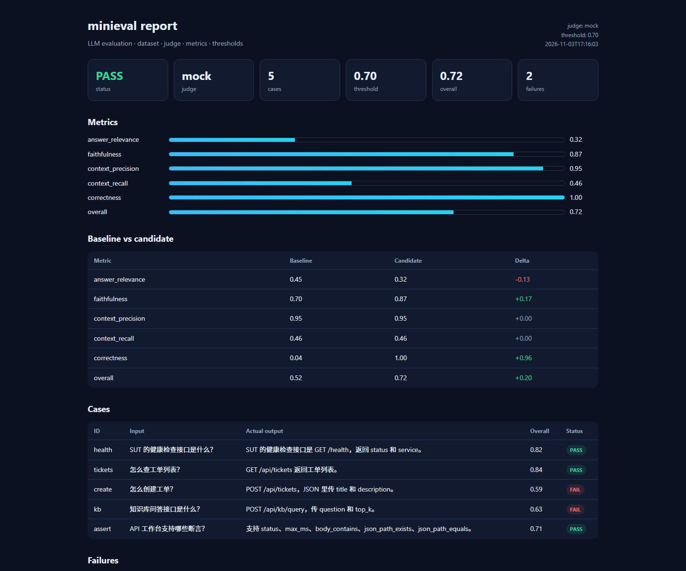

# 模块 08 验收：LLM 评测

## 1. 参考项目

| 项目 | Stars | License | 链接 | 为什么选它 |
|---|---:|---|---|---|
| confident-ai/deepeval | 19,242 | Apache-2.0 | https://github.com/confident-ai/deepeval | 最高星 LLM 评测框架，数据集、测试用例、指标、裁判、阈值模型清晰 |

本项目没有引入 DeepEval 依赖，也没有复制源码。实现方式是自建一个最小的评测引擎。

## 2. 复刻范围与非目标

### 已实现

- JSONL 数据集加载
- 测试用例模型：input / actual_output / expected_output / context / baseline_output
- 裁判：
  - `MockJudge`：确定性词法打分，CI 可用
  - `DeepSeekJudge`：可选，需 `DEEPSEEK_API_KEY`
- 指标：答案相关性、忠实度、上下文精确率、上下文召回率、正确性、总分
- 阈值判定
- Baseline vs candidate 对比
- JSON 报告
- 单文件离线 HTML 报告
- 命令行入口

### 明确不做

- 真实 RAG 检索链路
- 向量/embedding 指标
- 多裁判投票、人工标注平台
- 大规模数据集并行
- Prompt 调优闭环

## 3. 架构与数据流

```
dataset.jsonl
  → load_jsonl()
  → EvalCase[]
  → judge.score(case)
      → MockJudge：词法重叠
      → DeepSeekJudge：调用 DeepSeek 返回 JSON 分数
  → 指标聚合
  → 阈值判定
  → baseline vs candidate 对比
  → JSON + 离线 HTML
```

## 4. 原理

### 指标

- **answer_relevance**：回答和问题有多少词重叠；
- **faithfulness**：回答和上下文有多少词重叠；
- **context_precision**：上下文里有多少内容与参考答案相关；
- **context_recall**：参考答案有多少内容能在上下文里找到；
- **correctness**：回答覆盖了多少参考答案；
- **overall**：五项平均。

### MockJudge

不调用模型，直接用词法包含关系算分。优点是确定、免费、CI 可跑；缺点是不能理解同义表达。

### DeepSeekJudge

把问题、回答、参考答案、上下文发给 DeepSeek，要求返回 JSON：

```json
{"answer_relevance": 0.9, "faithfulness": 0.8, "correctness": 0.85}
```

上下文指标仍由本地词法计算，避免裁判模型编造。

### 阈值与对比

- 总分低于阈值：整体 FAIL；
- 单条用例低于阈值：记入 failures；
- baseline 和 candidate 分别跑一次，输出每个指标的 delta。

## 5. 使用步骤

```bash
cd /e/ailearning/ai-qa-lab

# 框架元测试（5 个）
./.venv/Scripts/python.exe -m pytest libs/minieval/tests -q

# 演示：baseline vs candidate，MockJudge
./.venv/Scripts/python.exe -m libs.minieval.demo.run_demo

# 或 CLI
./.venv/Scripts/python.exe -m libs.minieval \
  --dataset libs/minieval/demo/dataset.jsonl \
  --judge mock --compare --threshold 0.7 \
  --json docs/portfolio/module-08-llm-report.json \
  --html docs/portfolio/module-08-llm-report.html

# 可选：真实 DeepSeek 裁判
set DEEPSEEK_API_KEY=...
./.venv/Scripts/python.exe -m libs.minieval --dataset ... --judge deepseek
```

## 6. 运行结果

| 项目 | 结果 |
|---|---|
| 框架元测试 | 5 passed |
| 数据集 | 5 条 SUT 问答 |
| 裁判 | MockJudge（确定性） |
| baseline overall | 0.52 |
| candidate overall | 0.72 |
| delta | +0.20 |
| 整体判定 | PASS（阈值 0.70） |
| 单条失败 | 2 条（create、kb） |
| 报告 | `module-08-llm-report.html` + `.json` |
| 截图 | `module-08-llm-report.png` |

截图：



## 7. 与 DeepEval 的差异、取舍、踩坑

### 差异

- 没有真实 RAG、embedding、人工标注、多裁判投票。
- MockJudge 是词法打分，不理解同义表达；DeepSeekJudge 是可选增强。
- 数据集只有 5 条，用于演示闭环，不是基准集。

### 取舍

- 用确定性 MockJudge 保证 CI 稳定、零成本。
- 保留 DeepSeekJudge 接口，有 key 就能切换真实裁判。
- 先做“数据集 → 指标 → 阈值 → 对比报告”的主链路。

### 踩坑

1. **中文分词**：没有 jieba，用字符 + 英文单词做近似 token，够用但不完美。
2. **上下文指标容易虚高**：上下文和参考答案高度重叠时，precision/recall 会接近 1。
3. **MockJudge 有偏差**：词法重叠高不等于语义正确，同义表达会被低估。
4. **整体 PASS 不代表每条都好**：本次整体 0.72 通过，但 create/kb 两条单测低于阈值。
5. **DeepSeek 成本**：真实裁判每条一次 API 调用，数据集大时要注意预算。

## 8. 源码入口

| 文件 | 作用 |
|---|---|
| `libs/minieval/dataset.py` | EvalCase + JSONL 加载 |
| `libs/minieval/metrics.py` | 词法指标 |
| `libs/minieval/judges.py` | MockJudge / DeepSeekJudge |
| `libs/minieval/engine.py` | 评测、阈值、对比 |
| `libs/minieval/reporting.py` | JSON + 离线 HTML |
| `libs/minieval/cli.py` | 命令行入口 |
| `libs/minieval/tests/` | 5 个真实 pytest 元测试 |
| `libs/minieval/demo/` | 5 条数据集 + 运行脚本 |

## 9. 结论

模块 08 已形成完整闭环：数据集 → 裁判 → 指标 → 阈值 → 对比报告。它用 MockJudge 跑出 baseline 0.52 → candidate 0.72 的提升，并保留了接入 DeepSeek 真实裁判的接口。
