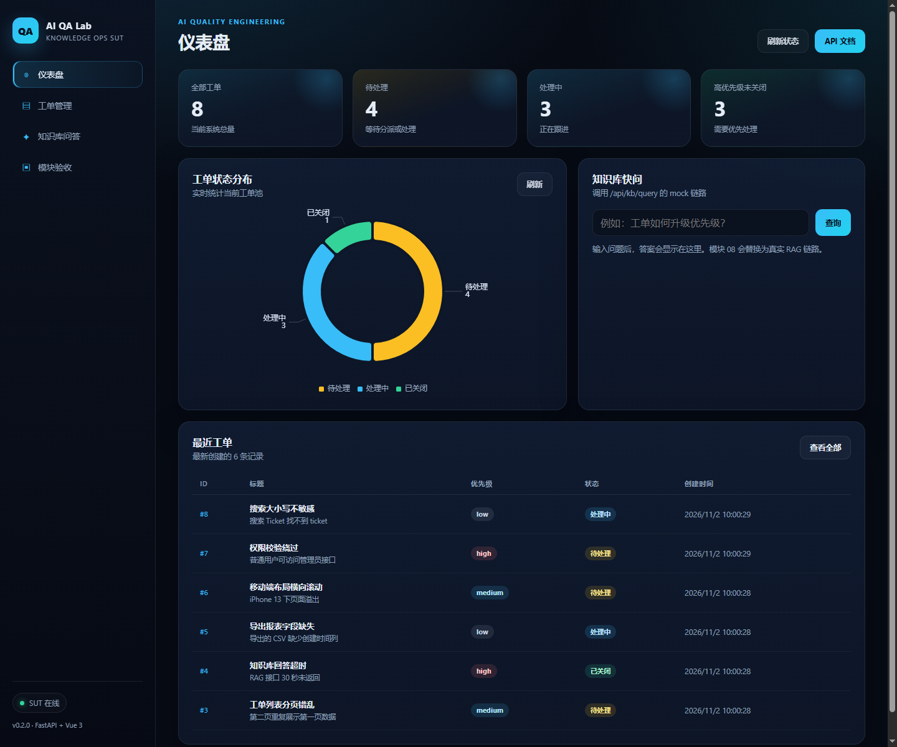
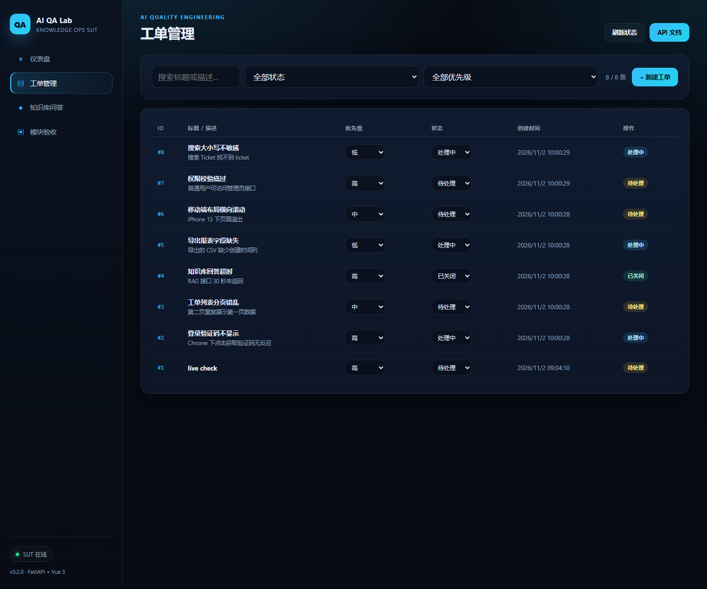
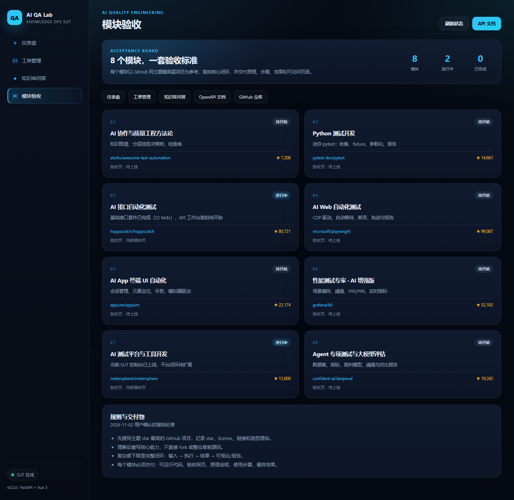

# SUT 控制台验收说明

> 验收日期：2026-11-02
> 项目：AI Knowledge Ops（统一被测系统）
> 技术栈：FastAPI + SQLAlchemy + SQLite · Vue 3 + Vite + Pinia + Vue Router + ECharts

## 1. 验收地址

本机启动后打开：

- 控制台：http://127.0.0.1:8000/ui/
- OpenAPI：http://127.0.0.1:8000/docs
- 健康检查：http://127.0.0.1:8000/health

## 2. 启动方式

一键启动（Git Bash）：

```bash
bash scripts/start_sut.sh
```

脚本会依次完成：创建 Python 3.11 venv、安装后端依赖、构建前端、启动 FastAPI。

手动启动：

```bash
cd /e/ailearning/ai-qa-lab
./.venv/Scripts/python.exe -m pip install -r requirements.txt -i https://pypi.tuna.tsinghua.edu.cn/simple
cd apps/sut/frontend && npm install && npm run build && cd ../..
./.venv/Scripts/python.exe -m uvicorn app.main:app --app-dir apps/sut/backend --port 8000 --reload
```

## 3. 页面与功能

| 页面 | 路由 | 功能 |
|---|---|---|
| 仪表盘 | `/ui/#/` | 工单总量、待处理、处理中、高优先级统计；状态环形图；最近工单；知识库快问 |
| 工单管理 | `/ui/#/tickets` | 搜索、状态/优先级筛选、新建工单、行内修改状态与优先级 |
| 知识库问答 | `/ui/#/knowledge` | 提问、Top K、耗时、回答、会话历史、建议问题 |
| 模块验收 | `/ui/#/portfolio` | 8 个模块的最高星参考项目、star、许可证、当前状态、验收入口 |

## 4. 架构与原理

```
Browser (Vue 3 SPA)
  ├─ Vue Router (hash 模式，避免静态托管的 404)
  ├─ Pinia (工单状态与统计)
  ├─ ECharts (状态分布图)
  └─ fetch /api/*
        │
        ▼
FastAPI (apps/sut/backend)
  ├─ /health
  ├─ /api/tickets  (GET/POST/PATCH)
  ├─ /api/kb/query (当前 mock，模块 08 换真实 RAG)
  ├─ /docs, /openapi.json
  └─ /ui  StaticFiles 挂载前端构建产物
        │
        ▼
SQLAlchemy → SQLite (sut.db)
```

关键设计：

1. **前后端同源**：前端构建产物由 FastAPI 在 `/ui` 挂载，避免额外部署一个静态服务器，验收只需一个端口。
2. **hash 路由**：静态托管不配置 fallback 也能刷新 `/ui/#/tickets`，减少部署复杂度。
3. **单一数据源**：工单状态只通过后端 API 修改，前端不做本地假数据，保证接口测试与 UI 测试覆盖同一条链路。
4. **测试隔离**：接口套件通过 `DATABASE_URL` 指向临时 SQLite，测试数据使用随机后缀，不污染开发库。

## 5. 验收结果

- 后端 + 接口套件：**28 passed**（`pytest apps/sut/backend suites/api -q`）
- 前端构建：`vite build` 成功，产物 `apps/sut/frontend/dist`
- 页面渲染：Chrome headless 实拍 3 张截图，见下方
- 数据流验证：创建工单 → 仪表盘统计变化 → 筛选/修改状态 → 列表同步

## 6. 截图

### 仪表盘



### 工单管理



### 模块验收



## 7. 已知边界

- 知识库接口仍是 mock，模块 08 接入 DeepSeek + 真实检索。
- 当前没有登录/权限，模块 07 复刻 MeterSphere 时补。
- 前端包体约 1.16 MB（ECharts 占大头），后续按路由拆包。
- 工单删除、分页、附件、评论尚未实现，按模块 03 的验收标准补齐。
